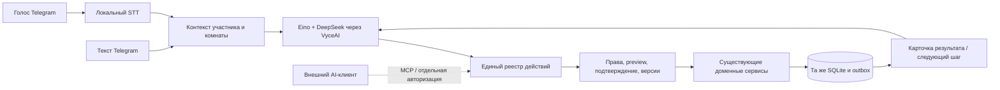

# Голосовой агент HomeQuest: исследование и решение

Проверено 16 ноября 2026. Запрос владельца: свободная речь для всех пользовательских
операций приложения, многошаговые поручения и контекст комнаты. Это исследование
с изолированным рабочим spike. Позже в этот же день внедрён первый этап: Eino,
контекст комнаты и 15 операций; [актуальный статус](STATUS.md). Ниже сохранено
полное архитектурное решение, включая ещё не реализованный внешний MCP и паритет.

## Рекомендация

Встроить **Eino ADK** в существующий Go-процесс, дать ему единый каталог разрешённых
действий HomeQuest. Тот же каталог позже открыть внешним клиентам через официальный
**MCP Go SDK**. Внутренний агент вызывает инструменты прямо в процессе: для голоса
в Telegram отдельный MCP-сервер, публичный HTTPS и второй сервис не нужны.

Полный охват означает все операции, доступные этому участнику в продукте:
дома/комнаты/задания/расписания/отчёты/награды/покупки/пожелания/настройки/Premium.
Сам агент не получает дополнительные права владельца, не может принять работу
за другого участника или прочитать скрытую бронь собственного подарка. Новые
возможности, которых пока нет в продукте, не появятся от подключения MCP.

## Как устроено в других продуктах

| Источник | Подтверждённое решение | Что перенять |
|---|---|---|
| [Todoist MCP v15.2.1](https://github.com/todoist/todoist-mcp/blob/v15.2.1/README.md), [tool design](https://github.com/todoist/todoist-mcp/blob/v15.2.1/docs/tool-design.md) | Инструменты можно использовать напрямую или через MCP. Операции сгруппированы по пользовательским сценариям; поддерживаются пачки и структурированные результаты | Один реестр инструментов для внутреннего агента и внешнего протокола; отдельные понятные действия поиска, создания, переноса |
| [Home Assistant LLM API](https://contributors.home-assistant.io/core/internals/llm-api/), [MCP](https://www.home-assistant.io/integrations/mcp_server/) | LLM API даёт инструменты и описание; контекст запроса содержит пользователя/ассистента/устройство. MCP может предоставлять те же наборы. Device control ограничивается exposed entities; более широкий административный набор существует отдельно | Контекст и права задаёт сервер; набор возможностей зависит от пользователя. Не копировать административный доступ как default |
| [Notion Agent](https://www.notion.com/help/notion-agent) | Агент получает текущую страницу/выделенные блоки как контекст, выполняет многошаговые задачи, действует с правами пользователя; документированы исключения из доступных действий | Выбранная комната и открытая карточка — явный фокус. Полный охват проверять матрицей, а не рекламным обещанием |
| [Linear Agent](https://linear.app/docs/linear-agent), [MCP](https://linear.app/docs/mcp) | История отдельных разговоров, контекст объектов рабочего пространства, существующие права; MCP подключает внешние данные/действия | Разделять личную беседу и общие семейные данные; показывать ход работы и результат |

Это исследованные подходы, не утверждение о переносе кода этих приложений.
Сервисы Todoist/Notion/Linear не подключались к данным семьи.

## Готовые компоненты

| Кандидат | Что уже готово | Вывод для HomeQuest |
|---|---|---|
| [Eino v0.9.23](https://github.com/cloudwego/eino/tree/v0.9.23) + [OpenAI adapter v0.1.13](https://github.com/cloudwego/eino-ext/tree/components/model/openai/v0.1.13/components/model/openai) | ChatModelAgent, цикл model→tool→model, типизированные инструменты, лимит итераций, последовательное исполнение, interrupt/resume и интерфейс checkpoint store | Первый выбор: проверен с нашим Go 1.24.3 и реальным gateway. Понадобятся собственные адаптеры доменных действий и SQLite-хранение сессии/контрольной точки |
| [Google ADK Go v2.7.1](https://github.com/google/adk-go/tree/v2.7.1), [database session service](https://pkg.go.dev/google.golang.org/adk/v2@v2.7.1/session/database) | Агентный runtime, подтверждения, модели, готовый GORM/SQLite session service | Сильная альтернатива с более готовым storage. Проверенный go.mod требует Go 1.26.10 и обновляет ряд общих зависимостей. Не запускался; выбора только по имени Google недостаточно |
| [Genkit Go](https://genkit.dev/docs/go/tool-calling/), [session stores](https://genkit.dev/docs/go/agents/session-stores/) | Цикл инструментов, типизированные interruptions, сохранение сессий и OpenAI-compatible интеграции | Подходит; исследованы документы, без отдельного запуска. Не добавляет достаточного преимущества поверх уже проверенного Eino для этой задачи |
| [LangGraph](https://docs.langchain.com/oss/python/langgraph/persistence) | Checkpoints, durable execution, interrupt, память потока и отдельное долговременное хранилище | Полезный образец восстановления. Python/TS-слой потребовал бы ещё одного runtime и интерфейса к Go-домену; сейчас не выбран |
| [MCP Go SDK v1.8.0](https://github.com/modelcontextprotocol/go-sdk/tree/v1.8.0) | Готовая реализация протокола client/server, transports и OAuth primitives | Для внешнего доступа. Это не планировщик и не память агента. Проверенный go.mod требует Go 1.25.0; отдельно обновить toolchain и выполнить regression gates перед внедрением |

Пины: Eino SHA `35480319ee8f6f75f612b4dce0bd5f4747b37730`;
OpenAI adapter tag commit `0ebab92e14f26088411dbc440a1ebdc904ccd8a1`;
MCP SDK SHA `3f3b699b2b67e1ed033a63d6651671dab53c2d32`.
Eino/адаптер — Apache-2.0 ([лицензия](https://github.com/cloudwego/eino/blob/v0.9.23/LICENSE-APACHE));
MCP SDK — [MIT](https://github.com/modelcontextprotocol/go-sdk/blob/v1.8.0/LICENSE).
Исходники зависимостей не vendored; эксперимент фиксирует модули и go.sum.

У Eino v0.9.23 interrupt/resume не означает автоматически готовую многопользовательскую
память в нашей SQLite. [Официальный пример](https://www.cloudwego.io/docs/eino/quick_start/chapter_03_memory_and_session/)
отделяет storage истории от framework. Развивающийся v0.10 durable runtime пока
[обсуждается как alpha](https://github.com/cloudwego/eino/discussions/1159);
его возможности не приписываются выбранному стабильному пину.

## Что уже доказано запуском

`experiments/agent-spike` — отдельный модуль; production go.mod не меняется.
Go 1.24.3 собрал Eino v0.9.23/OpenAI adapter v0.1.13. Реальный
`deepseek-4.1-flash-1017` через разрешённый VyceAI выполнил native tool calling:

1. Получил доверенный тестовый контекст: кухня, дата 16.11.2026, Europe/Berlin.
2. На «Перенеси все дела здесь на завтра» вызвал `get_room_tasks`.
3. Вызвал `prepare_reschedule` с ID, полученным из инструмента, и датой 17.11.2026.
4. Backend-заглушка проверила ID/порядок/дату и вернула `needs_confirmation`.

Результат: **PASS**, 1 чтение, 1 preview, 0 изменений. Это проверка реального
агентного цикла и gateway с синтетическими инструментами. Она НЕ доказывает
подключение к HomeQuest, распознавание речи, постоянную память, MCP, полномочия
или надёжное применение изменений. Native tool calls теперь подтверждены этим
smoke; ранее проверенный JSON Schema сам по себе такого доказательства не давал.

## Архитектура внедрения

Каждый инструмент принимает типизированные бизнес-поля. Actor/семья/права поступают
из доверенного execution context, а не из предложенных моделью user_id/family_id.
Результат содержит статусы, ID, версии, число изменённых объектов и возможный
следующий шаг; итог пользователю строится по фактическим результатам выполнения.

Вынести общее выполнение пользовательских операций из отдельных bot handlers
в прикладные use cases: кнопки и агент должны вызывать одинаковый код. Нельзя
строить агент вокруг имитации кликов или автоматически открывать старый admin API.
Расписание, ledger, approval, награды и секретные DTO остаются в существующем домене.

Практичные группы инструментов: контекст/поиск; задания и расписания; комнаты и
наборы; очередь/передача; фото/проверка; покупки; награды; wishlist; статистика;
личные настройки; семейное управление; manual-test Premium. Поиск инструментов
и раскрытие нужных групп удерживают контекст компактным. Один универсальный
`execute(anything)` не заменяет отдельные проверяемые схемы действий.

## Контекст комнаты и память

«Дом» — семья/circle, «комната» — кухня/ванная и т. п., «диалог» — личная беседа.
Эти три области не смешиваются. Телефон не сообщает автоматически физическую
комнату: фокус задаётся выбором в UI, reply на карточку или явной фразой пользователя.

Серверная AgentSession: actor, active family, room focus, текущая карточка/выделенные
объекты, локальное время семьи, revision контекста, pending plan, короткая история
и ссылки на последние результаты. Сессия принадлежит пользователю; один участник
не меняет фокус другого. Общими остаются только разрешённые факты из БД.

Порядок разрешения ссылок:
1. Явное «в ванной» в текущей фразе — найти комнату в активном доме.
2. Ответ на карточку — проверить её связь с объектом и активным домом.
3. «Здесь/в этой комнате» — выбранная комната; «это/второе» — последний релевантный
   объект/список. Если есть несколько толкований, задать короткий вопрос.
4. Без фокуса и без однозначного объекта — уточнение, не произвольный выбор.

Показывать «Контекст: Тёплый дом → Кухня» и дать действия «Сменить»/«Сбросить».
Смена дома сбрасывает комнату и отделяет историю; поздний ответ модели не должен
применить план в новом контексте. Автообновление старой карточки не меняет фокус.
Для обоих режимов UI контекст записывается при намеренном пользовательском действии.
Текущий CardView хранится только для Widgets и недостаточен для этой задачи;
Message сейчас не содержит reply_to_message, его нужно добавить в адаптер.

Свежие задачи, цены, остатки, состав семьи и право просмотра всегда читаются из БД.
В память не копируется «истина» о балансе. Краткая история и checkpoints — с TTL,
очисткой и минимальным содержимым; сырое аудио по-прежнему удаляется. Семейные
заметки о комнате можно хранить отдельно от личного диалога. Тексты задач и заметок
считаются данными, а не инструкциями менять права. Тайная бронь исключается ДО
формирования контекста, также из summary/checkpoints и результатов инструментов.
Для этих структурированных данных векторная база/RAG на старте не нужна.

## Автономность без подтверждения каждого шага

Чтение, поиск, расчёты выполняются автоматически. Ясное разрешённое обратимое
изменение может выполняться сразу с отчётом и доступной отменой. Уже принятое
продуктовое правило сохраняется: создание задач и shopping draft сначала показывают
preview; одно однозначное выполнение может пройти сразу, с undo.

Массовые переносы, списание за награду, удаление/исключение и передача владения —
один понятный preview с объектами/эффектом и подтверждение всей операции, а не
разрешение на каждый внутренний tool call. Новые defaults согласуются при реализации;
не менять существующие продуктовые ограничения молча.

PendingPlan хранит конкретные аргументы, actor, family, версии объектов, срок
годности и хеш плана. Подтверждение привязано к этому плану; фраза «да» не разрешает
модели придумать другой. После паузы права/версии проверяются заново. Локальную пачку
изменений фиксировать транзакционно; внешние сообщения — через outbox. Не держать
SQLite-транзакцию открытой во время запроса к модели. При частичном результате
честно перечислять выполненное/невыполненное; компенсация только где предусмотрена.

Checkpoint не заменяет идемпотентность: уникальный ключ run/step/операции и доменный
эффект должны фиксироваться атомарно. Ограничить шаги, длительность, стоимость,
повторы; дать «Остановить». Остановка прерывает будущие шаги, не скрыто отменяет уже
принятые факты. Требование фото и согласия другого взрослого сохраняется.

## Где нужен MCP

Внешние клиенты ChatGPT/Claude/Codex смогут читать контекст и вызывать те же действия
через MCP. Это отдельная граница: HTTPS, авторизация от конкретного участника,
отзываемые права/сроки, явный активный дом. Для Telegram-встроенного агента достаточно
доверенного update и внутренних вызовов.

Не передавать Telegram bot token/ключ VyceAI клиентам и не использовать общий
root/admin token. Проверять audience и scopes на каждом вызове; SDK предоставляет
примитивы, но не готовое сопоставление OAuth→участник HomeQuest.
[Спецификация MCP tools](https://modelcontextprotocol.io/specification/2026-07-28/server/tools)
описывает discovery/вызовы/annotations, а [authorization security](https://modelcontextprotocol.io/specification/2026-07-28/basic/authorization/security-considerations)
— требования к токенам. Annotations не заменяют серверные права и подтверждения.
MCP Apps и Telegram Widgets — разные поверхности; их HTML нельзя считать взаимозаменяемым.

## Порядок работ и критерии готовности

1. **Паритет действий:** реестр всех продуктовых операций, схемы и общие use cases;
   у каждого действия UI есть инструмент или явная причина ограничения. Автоматический
   gate замечает новый UI action без классификации. Игровые инварианты не меняются.
2. **Контекст:** persistent сессия дома/комнаты/карточки, reply, ссылка «это», TTL,
   явная смена/сброс, разделение пользователей и домов.
3. **Вертикальный агент:** Eino → реальные use cases → preview/apply → outbox;
   первое поручение «перенеси мои дела в этой комнате на завтра» с управляемым временем.
4. **Полный охват:** остальные группы, многошаговые задачи, уточнения, stop/undo,
   restart, подтверждения в текущих HTML-карточках; живой русский voice отдельно.
5. **Внешний MCP:** когда нужен вход из других AI-клиентов — официальный SDK,
   обновление toolchain с regression gates, OAuth/привязка, MCP-клиентские тесты.

Обязательные E2E новой версии: одинаковые названия в кухне/ванной; два дома и два
участника; «это/здесь/второе» после навигации; reply на старую карточку; смена дома
во время LLM-вызова; удалённая комната; исключение между preview/apply; изменение
цены/срока после preview; повтор update/подтверждения после restart; падение после
DB commit до checkpoint; отрицание/неуверенность/ошибка STT; prompt injection в
названии; секретная бронь во всех tool outputs/memory; голосовое подтверждение
не того pending plan; ограничения бюджета и остановка посреди цепочки.

Тестовые модели детерминированы в CI; небольшие real-model eval отдельно. Успешный
spike не позволяет отметить эти будущие E2E пройденными. Следующий шаг — пункт 1,
с сохранением существующих зелёных сценариев и Donetick как доменной базы.
